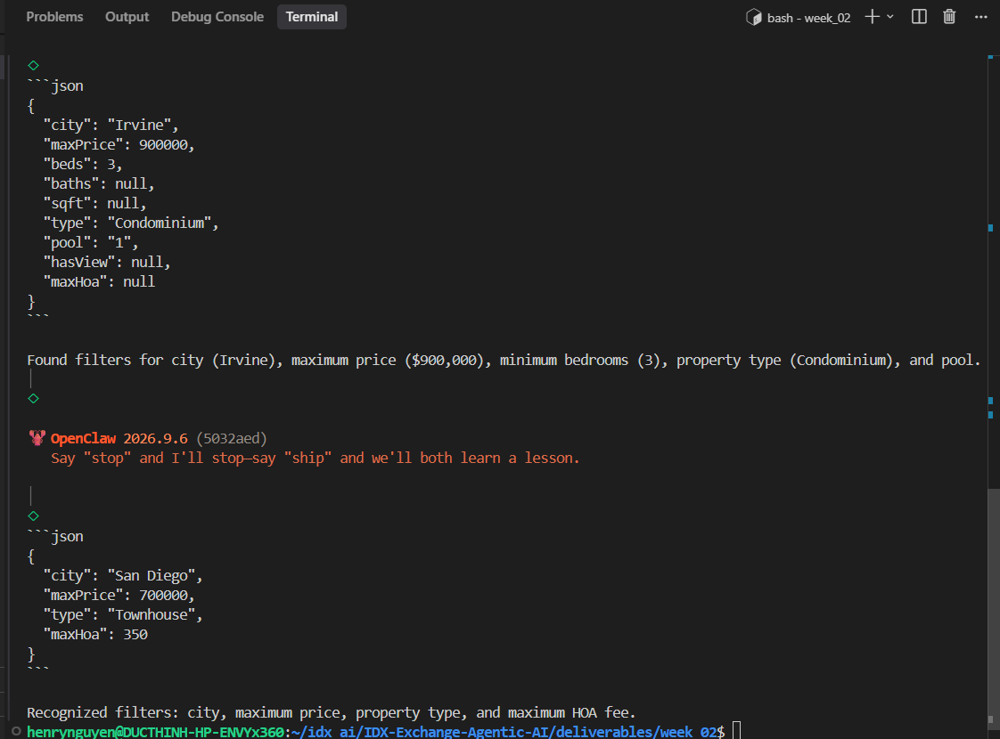

# Week 2 - Natural-Language Property Search Skill

## Objective

Build an OpenClaw skill that accepts a free-text home search and returns a structured
filter object for the `rets_property` table, validated against at least 10 test queries.

Example:

> Show me 3-bedroom condos in Irvine under $1.5M with a pool.

```json
{
  "city": "Irvine",
  "maxPrice": 1500000,
  "beds": 3,
  "baths": null,
  "sqft": null,
  "type": "Condominium",
  "pool": "1",
  "hasView": null,
  "maxHoa": null
}
```

Running the actual MySQL query is the Week 3 deliverable. This skill only produces the filters.

---

## Files

| File | Purpose |
|------|---------|
| `parseQuery.ts` | The parser: `parsePropertyQuery(query)` returns a `PropertyFilters` object |
| `parse.ts` | Command-line entry point used by the skill: `node parse.ts '<query>'` prints JSON |
| `test.ts` | 13 test queries with expected output (`node test.ts`, or `--markdown` for the table below) |
| `SKILL.md` | The OpenClaw skill definition: when to use it, how to call the parser safely, how to reply |
| `package.json` | `npm test` and `npm run install-skill` scripts |
| `tsconfig.json` | Editor type checking only; Node runs the `.ts` files directly |

Requires Node 22.18+ (native TypeScript type stripping). No build step and no runtime dependencies.

---

## Filter Mapping

Column names and values were checked against the live `rets_property` data (55,212 active residential listings).

| Key | `rets_property` column | Match | Example phrases |
|-----|------------------------|-------|-----------------|
| `city` | `L_City` | equals | "in Irvine", "in los angeles" |
| `maxPrice` | `L_SystemPrice` | at most | "under $1.5M", "below 900k", "up to 750,000" |
| `beds` | `L_Keyword2` | at least | "3 bed", "3-bedroom", "2br", "3+ beds" |
| `baths` | `LM_Dec_3` | at least | "2.5 baths", "2+ baths" |
| `sqft` | `LM_Int2_3` | at least | "1,800 sqft", "2,000 square feet" |
| `type` | `L_Type_` | equals | condo, townhome, single family, duplex, fourplex, cabin, co-op, ... |
| `pool` | `PoolPrivateYN` | equals `"1"` | "with a pool" (but not "no pool") |
| `hasView` | `ViewYN` | equals `"1"` | "with a view", "ocean view" |
| `maxHoa` | `AssociationFee` | at most | "HOA under $300", "max HOA 400" |

A key is `null` when the query does not mention it, so the Week 3 query layer can skip that condition.

---

## Test Results

`node test.ts --markdown` (null keys omitted):

| Query | Parsed filters (non-null) | Result |
|---|---|---|
| Show me 3-bedroom condos in Irvine under $1.5M with a pool. | `{"city":"Irvine","maxPrice":1500000,"beds":3,"type":"Condominium","pool":"1"}` | Pass |
| single family in San Diego, 2.5 baths, 1,800 sqft, HOA under $300, ocean view, budget 900k | `{"city":"San Diego","maxPrice":900000,"baths":2.5,"sqft":1800,"type":"SingleFamilyResidence","hasView":"1","maxHoa":300}` | Pass |
| Townhomes in Long Beach under 800k | `{"city":"Long Beach","maxPrice":800000,"type":"Townhouse"}` | Pass |
| 4 bed 3 bath house in Los Angeles below $2 million | `{"city":"Los Angeles","maxPrice":2000000,"beds":4,"baths":3}` | Pass |
| Homes with a view in Palm Springs | `{"city":"Palm Springs","hasView":"1"}` | Pass |
| condo in San Jose with no pool, max HOA 400 | `{"city":"San Jose","type":"Condominium","maxHoa":400}` | Pass |
| 2br condo under 650k | `{"maxPrice":650000,"beds":2,"type":"Condominium"}` | Pass |
| Looking for a duplex in Oakland, at least 2,000 square feet | `{"city":"Oakland","sqft":2000,"type":"Duplex"}` | Pass |
| cabin in Lake Arrowhead under $500k with mountain views | `{"city":"Lake Arrowhead","maxPrice":500000,"type":"Cabin","hasView":"1"}` | Pass |
| I am interested in a 3 bed single-family home in Temecula up to 750,000 | `{"city":"Temecula","maxPrice":750000,"beds":3,"type":"SingleFamilyResidence"}` | Pass |
| 3+ beds, 2+ baths in Riverside with pool under 600k | `{"city":"Riverside","maxPrice":600000,"beds":3,"baths":2,"pool":"1"}` | Pass |
| fourplex in los angeles under 2.5m | `{"city":"Los Angeles","maxPrice":2500000,"type":"Quadruplex"}` | Pass |
| Show me something nice | `{}` | Pass |

**13/13 passed.**

---

## Live Agent Run

Tested through OpenClaw 2026.9.6 with `google/gemini-3.5-flash-lite`. The session trace
shows the agent read `SKILL.md`, then ran the parser with the request in single quotes:

```bash
openclaw agent --session-id week2-live-3 --message 'Find me a 3 bed condo in Irvine under 900k with a pool'
# agent ran: node .../skills/nl-property-search/parse.ts 'Find me a 3 bed condo in Irvine under 900k with a pool'
# -> {"city":"Irvine","maxPrice":900000,"beds":3,"type":"Condominium","pool":"1", ...}

openclaw agent --session-id week2-live-4 --message 'Show me a townhouse in San Diego under $700k, no pool, HOA under 350'
# agent ran: node .../skills/nl-property-search/parse.ts 'Show me a townhouse in San Diego under $700k, no pool, HOA under 350'
# -> {"city":"San Diego","maxPrice":700000,"type":"Townhouse","pool":null,"maxHoa":350, ...}
```

The second query confirms the shell-safety rule: `$700k` reached the parser unchanged.



---

## Running It

```bash
cd deliverables/week_02
npm install                      # editor types only
npm test                         # run the 13 test queries
node parse.ts 'Townhomes in Long Beach under 800k'
npm run install-skill            # copy the skill into ~/.openclaw/workspace/skills/
openclaw skills list             # nl-property-search should show as ready
```

The skill is copied rather than symlinked because OpenClaw rejects skill symlinks that
resolve outside its skills folder.

---

## Design Notes

**Values come from the data, not the handbook.** Checking `rets_property` showed that
`PoolPrivateYN` and `ViewYN` store `"1"` (not `"True"`), and property types use RESO names
such as `SingleFamilyResidence`, `Condominium`, and `Quadruplex`. The parser outputs those
exact values so Week 3 can use them directly in `WHERE` clauses.

**Comma-aware numbers.** "1,800 sqft" and "up to 750,000" are read as 1800 and 750000.
A simpler `\d+` pattern would read only the digits after the comma.

**HOA is parsed first.** "HOA under $300 ... budget 900k" would otherwise be read as a
$300 price limit, so the HOA phrase is extracted and removed before the price is parsed.

**Shell safety.** The agent runs the parser with the `exec` tool, and the query is untrusted
user text (from WhatsApp in later weeks). `SKILL.md` tells the agent to always pass it in
single quotes, never double quotes, so characters like `$` and backticks cannot run as
shell commands.

**No invented answers.** In an early run the agent could not execute the parser and wrote
plausible but wrong JSON itself (`"type": "condo"`, `"pool": "0"`). `SKILL.md` now tells the
agent to return only what the script printed and to report errors instead.

**Code Mode must be off.** OpenClaw automatically enables its experimental Code Mode for
some models (including `gemini-3.5-flash-lite`). In Code Mode the model's `exec` tool runs
JavaScript, not shell commands, so the skill cannot call the parser. Setting
`openclaw config set tools.codeMode false` restores the shell `exec` tool.

---

## Limitations

- Rule-based (regular expressions), so unusual phrasing can be missed, such as
  "no more than three bedrooms" or "around a million".
- Only one city per query; if several appear, the last "in <place>" wins.
- "House" or "home" alone does not set a type, because it could mean several of them.
- Minimum price ("over 500k") is not supported yet.
