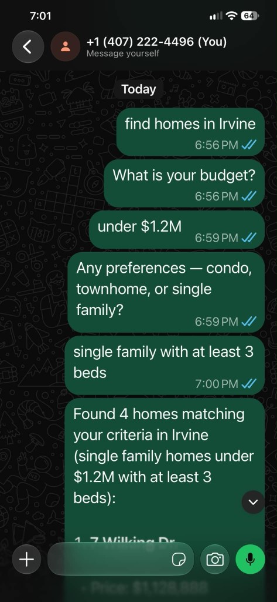
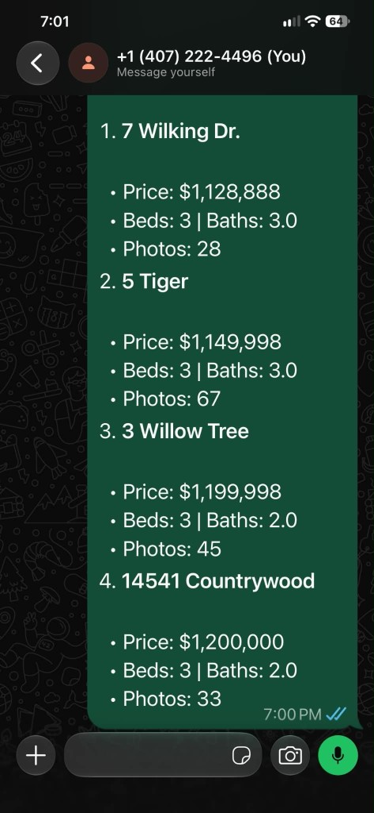

# Week 4 - Conversational Property Search

## Objective

Turn the Week 3 one-shot listing search into a multi-turn conversation. The agent remembers filters for one user, asks for the next missing piece, then returns `rets_property` cards.

Example on WhatsApp:

> find homes in Irvine
> What is your budget?
> under $1.2M
> Any preferences — condo, townhome, or single family?
> single family with at least 3 beds
> Found 4 homes...

Required filters, in order: city, budget, property type. Beds are saved when mentioned, but a search can run without them.

---

## Files

| File | Purpose |
|------|---------|
| `session.ts` | Per-user filters, saved to `sessions.json` so each new process keeps the same chat |
| `turn.ts` | Parse the latest message, merge filters, ask the next question or mark ready |
| `chat.ts` | CLI entry: `node chat.ts <userId> '<message>'`. Queries MySQL only when ready |
| `mls/` | Week 3 parser, pool, and active-listing search, copied so the skill is self-contained |
| `SKILL.md` | OpenClaw skill `property-chat` |
| `package.json` | `mysql2`, `dotenv`, and `npm run install-skill` |
| `tsconfig.json` | Editor type checking only |

`sessions.json` is local runtime state and is gitignored.

---

## CLI check

Three separate processes, same user id:

```bash
cd deliverables/week_04
node chat.ts henry-week4 'Find homes in Irvine'
node chat.ts henry-week4 'Under $1.2M'
node chat.ts henry-week4 'Single family with at least 3 beds'
```

The third command returned 4 Irvine single-family homes, first address `7 Wilking Dr.` at $1,128,888.

---

## WhatsApp run

Gateway up, WhatsApp linked, group policy set to `disabled` so direct messages are not blocked by an empty group allowlist. Same three turns on the linked chat:





Install the skill into the coordinator workspace:

```bash
npm run install-skill
openclaw skills list --agent coordinator   # property-chat should be ready
```

`SKILL.md` tells the agent to pass a stable user id and only the latest message, in single quotes.
