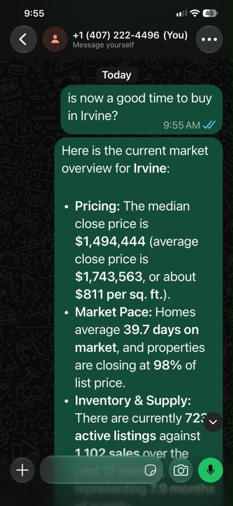
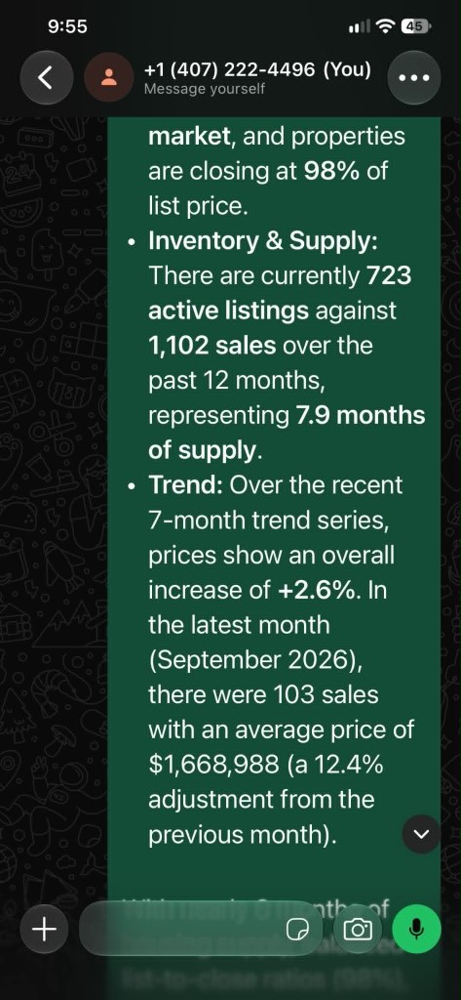
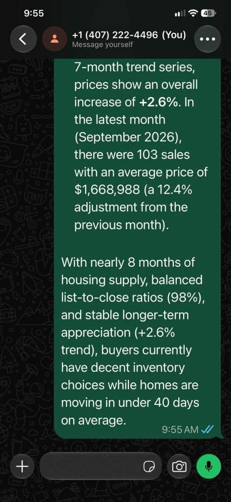

# Week 5 - Market Statistics Agent

## Objective

Answer city-level market questions from `california_sold` and `rets_property`. The skill returns a data-backed summary, not individual listings.

Example:

> Is now a good time to buy in Irvine?

The city must appear as `in <city>`. Residential sales from the last 12 months are used. This database only has closes from March through September 2026, so the trend has 7 months rather than 12.

Every recognized question returns the same summary: median price, days on market, list-to-close ratio, inventory, and the trend. A question with no `in <city>` does not run a search.

| Question | Result |
|----------|--------|
| Is now a good time to buy in Irvine? | Irvine. Median $1,494,444, 39.7 days on market, 98% list-to-close |
| What is the average price per sq ft in Pasadena? | Pasadena. $827 per sq ft, median $1,292,385 |
| How many days on market in San Diego? | San Diego. 27.6 days on market, median $950,000 |
| Is now a good time to buy in Long Beach? | Long Beach. Median $860,000, 5.9 months of supply |
| Irvine market stats | No city found. Ask again with "in Irvine" |

---

## Files

| File | Purpose |
|------|---------|
| `db.ts` | MySQL pool. Loads `~/projects/idx_ai/.env` by home path first |
| `citySummary.ts` | Sold count, average and median close price, price per sqft, days on market, list-to-close percent |
| `trend.ts` | Monthly sales, average price, and month-to-month price change |
| `inventory.ts` | Active listings versus 12-month sales, plus months of supply |
| `market.ts` | One question in. Combines the three reports |
| `SKILL.md` | OpenClaw skill `market-stats` |
| `package.json` | `mysql2`, `dotenv`, and `npm run install-skill` |
| `tsconfig.json` | Editor type checking only |

---

## CLI check

```bash
cd deliverables/week_05
node citySummary.ts Irvine
node trend.ts Irvine 12
node inventory.ts Irvine
node market.ts 'Is now a good time to buy in Irvine?'
```

Irvine results used in the live test:

| Figure | Value |
|--------|-------|
| Median close price | $1,494,444 |
| Average close price | $1,743,563 |
| Price per sqft | $811 |
| Average days on market | 39.7 |
| List-to-close | 98% |
| Sold in last 12 months | 1,102 |
| Active listings | 723 |
| Months of supply | 7.9 |
| Trend, March to September | +2.6% |
| September versus August | -12.4% (103 sales, average $1,668,988) |

---

## WhatsApp run

`market-stats` was installed on the coordinator and answered the same Irvine question:







```bash
npm run install-skill
openclaw skills list --agent coordinator   # market-stats should be ready
```
