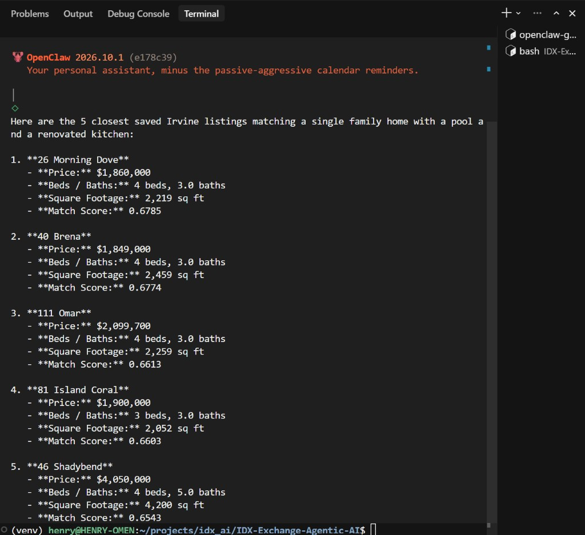

# Week 6 - Semantic search

Weeks 3 and 4 find homes when I already know the city, the budget, and the type. This week I wanted a sentence to be enough. "Pool and a renovated kitchen" does not map cleanly onto a SQL filter, so I turn the listing text and the sentence into vectors and keep the closest ones.

I used Gemini `gemini-embedding-001`, not OpenAI. Each vector is 768 numbers. Gemini does not normalize that shorter size for me, so the script does it. After that the length is 1, and closeness is just the dot product. Listings are embedded as `RETRIEVAL_DOCUMENT`. The question is embedded as `RETRIEVAL_QUERY`.

I am not embedding all 55,000 listings every time someone asks. Irvine alone has 720 active listings with remarks. I embedded the first 40 once and saved them in `vectors.json`. A search embeds only the question, then ranks those 40. The file is gitignored. Anyone cloning the repo has to build it again.

---

## Files

| File | Purpose |
|------|---------|
| `db.ts` | MySQL pool. Loads `~/projects/idx_ai/.env` by home path first |
| `embed.ts` | Builds the listing paragraph and calls Gemini for one vector |
| `buildIndex.ts` | Embeds the next Irvine listings and appends them to `vectors.json` |
| `similar.ts` | Embeds one description and prints the 5 closest saved listings |
| `SKILL.md` | OpenClaw skill `semantic-search` |
| `package.json` | `mysql2`, `dotenv`, and `npm run install-skill` |
| `tsconfig.json` | Editor type checking only |

---

## CLI check

```bash
cd deliverables/week_06
node embed.ts
node buildIndex.ts 40
node similar.ts 'single family home with a pool and a renovated kitchen'
```

`embed.ts` picked one Irvine single-family listing, `1136991548`. The paragraph was 886 characters. The vector came back with 768 dimensions and length 1.

`buildIndex.ts 40` saved 40 listings. Running it again does not repeat those 40. It takes the next ones, so I left the file at 40.

The similar-listing command returned:

| Score | Address | Price | Beds | Baths | Sq ft |
|------:|---------|------:|-----:|------:|------:|
| 0.6785 | 26 Morning Dove | $1,860,000 | 4 | 3 | 2,219 |
| 0.6774 | 40 Brena | $1,849,000 | 4 | 3 | 2,459 |
| 0.6613 | 111 Omar | $2,099,700 | 4 | 3 | 2,259 |
| 0.6603 | 81 Island Coral | $1,900,000 | 3 | 3 | 2,052 |
| 0.6543 | 46 Shadybend | $4,050,000 | 4 | 5 | 4,200 |

A score of 1 would mean the same vector. These are around 0.65 to 0.68, which is "related," not a copy.

---

## Coordinator

```bash
npm run install-skill
openclaw skills list --agent coordinator   # semantic-search should be ready
```

The gateway has to be running in another terminal (`openclaw gateway`). Then:

```bash
openclaw agent --agent coordinator --session-id week6-live-2 \
  --message 'Find a single family home with a pool and a renovated kitchen'
```

That reply listed the same five homes, in the same order, with the same scores.



The first session, `week6-live-1`, also called the older MLS skill. It added pool homes in Desert Hot Springs, Palm Springs, Bakersfield, Blythe, and Joshua Tree. Those were not in the saved index. I changed the skill descriptions so a sentence like this stays on `semantic-search`, reinstalled the skills, and used a new session. `week6-live-2` stayed on the five Irvine homes.
