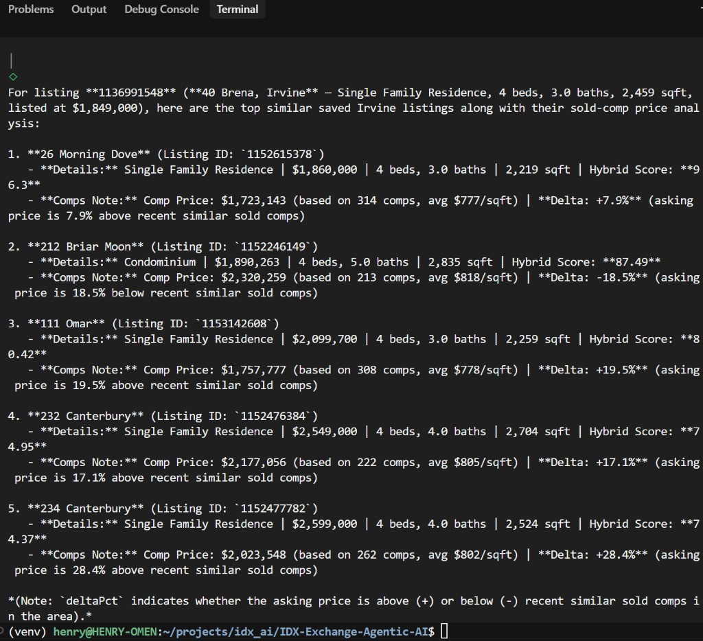

# Week 7 - Recommendation engine

Week 6 matched a free-text sentence to saved listings. This week starts from a home I already like and asks for similar active ones, then checks whether each ask makes sense against recent sold comps.

The handbook score is hybrid. Structured fields get up to 60 points: price buckets, same beds, same city, sqft buckets. Embedding cosine similarity fills the other 40. I reused the Week 6 Gemini vectors (`gemini-embedding-001`, 768 dims, already normalized). No new OpenAI dependency.

The candidate pool is still those 40 saved Irvine listings, not the full MLS. `vectors.json` stays gitignored. The sold-comp check queries `california_sold` for Residential closes in the last 6 months, living area within ±20% of the home, then compares list price to `avg $/sqft × sqft`.

The handbook does not give a sample listing id. I used `1136991548` (40 Brena) because that was the first active Irvine listing with remarks in Week 6, and it is already in the saved index.

---

## Files

| File | Purpose |
|------|---------|
| `db.ts` | MySQL pool. Loads `~/projects/idx_ai/.env` by home path first |
| `score.ts` | Structured similarity only (max 60) |
| `hybrid.ts` | Structured + embedding cosine × 40 |
| `comps.ts` | Sold-comp price check for one city / sqft / list price |
| `recommend.ts` | Top 5 hybrid matches with a comps note on each |
| `SKILL.md` | OpenClaw skill `recommend-listings` |
| `package.json` | `mysql2`, `dotenv`, and `npm run install-skill` |
| `tsconfig.json` | Editor type checking only |

---

## CLI check

`1136991548` is the liked listing (40 Brena). The first three commands build the pieces. The last one is the full deliverable.

```bash
cd deliverables/week_07

# Structured score only: price, beds, city, sqft. Max 60. No Gemini call.
node score.ts 1136991548

# Same ranking with embeddings added: structured + cosine × 40. Max 100.
# Uses the saved Week 6 vectors, so still no API call.
node hybrid.ts 1136991548

# One sold-comp check for 26 Morning Dove (2219 sq ft, ask $1,860,000).
# Needs MySQL. Returns avg $/sqft, implied compPrice, and deltaPct.
node comps.ts Irvine 2219 1860000

# Full flow: top 5 hybrid matches, each with its own comps note.
node recommend.ts 1136991548
```

Liked home: 40 Brena, $1,849,000, 4 beds, 2,459 sq ft.

Top hybrid recommendations from `recommend.ts`:

| Total | Structured | Semantic | Address | Price | deltaPct |
|------:|-----------:|---------:|---------|------:|---------:|
| 96.3 | 60 | 36.3 | 26 Morning Dove | $1,860,000 | +7.9% |
| 87.49 | 55 | 32.49 | 212 Briar Moon | $1,890,263 | -18.5% |
| 80.42 | 45 | 35.42 | 111 Omar | $2,099,700 | +19.5% |
| 74.95 | 40 | 34.95 | 232 Canterbury | $2,549,000 | +17.1% |
| 74.37 | 40 | 34.37 | 234 Canterbury | $2,599,000 | +28.4% |

`Total` = structured + semantic. Positive `deltaPct` means the ask is above what similar recent Irvine sales imply. Negative means below. 26 Morning Dove used 314 comps at about $777 / sq ft.

---

## Coordinator

`install-skill` copies the scripts, `node_modules`, and the Week 6 `vectors.json` into the coordinator skill folder. Use a new session id so the agent does not reuse an older turn.

```bash
npm run install-skill
openclaw skills list --agent coordinator   # recommend-listings should be ready
```

Gateway running in another terminal (`openclaw gateway`), then:

```bash
openclaw agent --agent coordinator --session-id week7-live-1 \
  --message 'I like listing 1136991548. Recommend similar homes and check their prices against comps.'
```

That reply named 40 Brena as the liked home and returned the same five listings, scores, and comps notes as the CLI.


