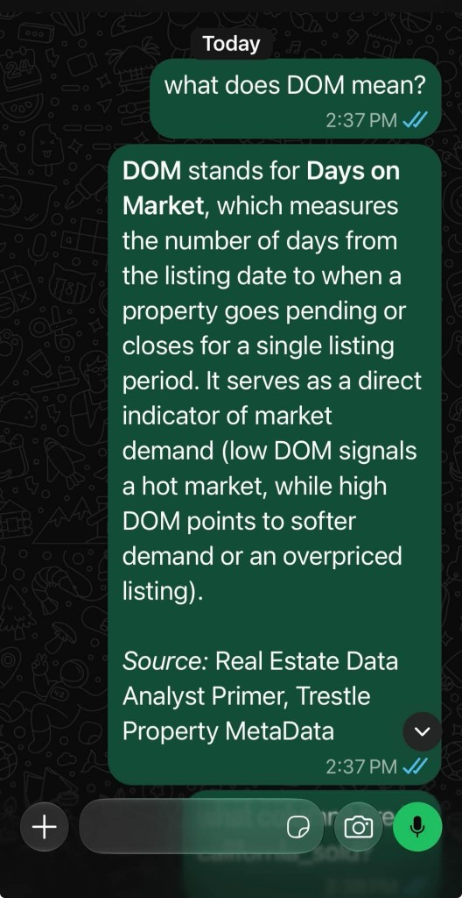
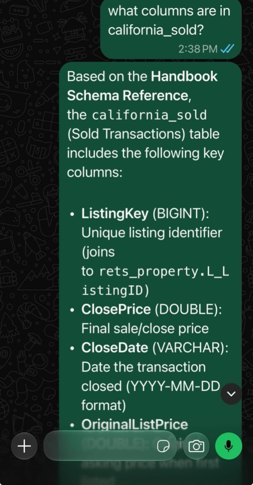
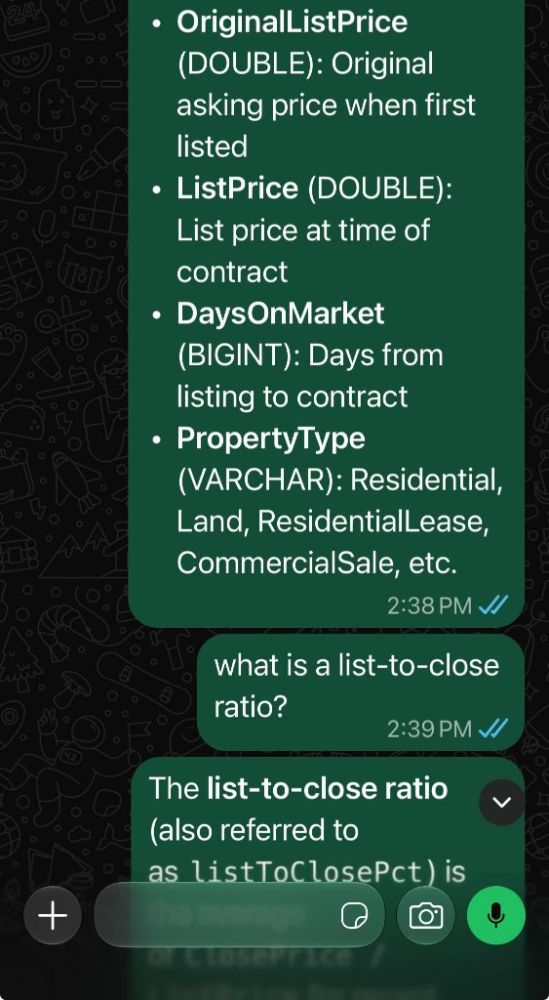
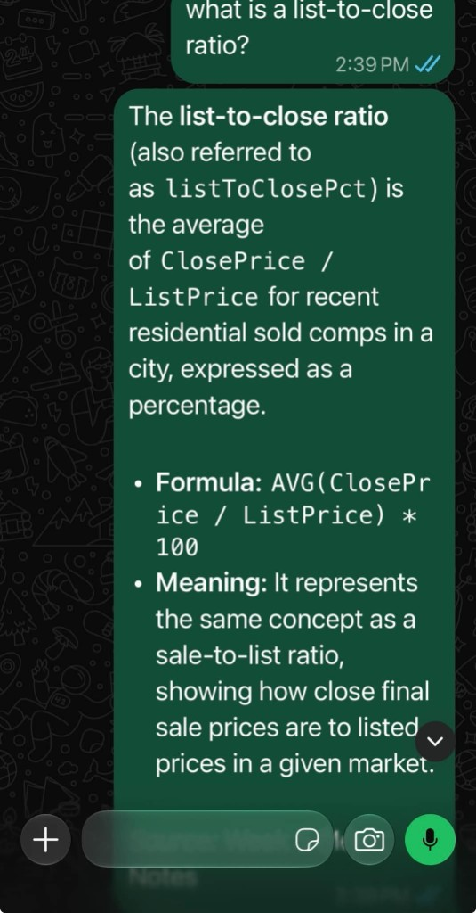

# Week 8 - RAG knowledge assistant

Weeks 3–7 answer listing and market questions from MySQL and embeddings. This week answers definitions from documents: what DOM means, what columns are in a table, what list-to-close is. The model only sees retrieved chunks, so it should not invent glossary text.

Pipeline: load sources → chunk (600 chars, 100 overlap) → embed once with Gemini `gemini-embedding-001` (768 dims) → on each question embed the query, take the top chunks, ask Gemini `gemini-3.5-flash-lite` to answer from that context only. Same Gemini stack as earlier weeks, not the handbook’s OpenAI sample.

## Sources indexed

| Source | Why |
|--------|-----|
| Real Estate Data Analyst Primer | Terminology (DOM, etc.) |
| Trestle Property MetaData | RESO field definitions |
| Week 5 market README | Market-stats context |
| Handbook schema pages 4–6 | `california_sold` / `rets_property` columns |
| `metric-notes.md` | List-to-close formula as used in Week 5 |

PDFs stay under `~/projects/idx_ai/handbooks` (outside the git repo). Extracted text lands in `sources/` and is gitignored. The embedding file `rag-index.json` is also gitignored (271 chunks after the full build). Anyone cloning the repo runs `node chunk.ts` then `node buildIndex.ts` again. Free-tier embed rate limits pause the build; the script resumes from what was already saved.

---

## Files

| File | Purpose |
|------|---------|
| `env.ts` | Loads `~/projects/idx_ai/.env` for `GEMINI_API_KEY` |
| `chunk.ts` | Loads sources and splits them into overlapping chunks |
| `embed.ts` | Gemini embedding helper |
| `buildIndex.ts` | Embeds chunks once into `rag-index.json` |
| `rag.ts` | Retrieve top chunks and generate a grounded answer |
| `metric-notes.md` | Short Week 5 metric definitions (list-to-close) |
| `SKILL.md` | OpenClaw skill `mls-rag` |
| `package.json` | `dotenv` and `npm run install-skill` |
| `tsconfig.json` | Editor type checking only |

---

## CLI check

```bash
cd deliverables/week_08

# Load the three handbook sources (+ schema + metric notes) and print chunk counts.
node chunk.ts

# Embed every chunk once. Safe to re-run; already-saved chunks are skipped.
node buildIndex.ts

# Full RAG turn: embed the question, retrieve, generate.
node rag.ts 'What does DOM mean?'
node rag.ts 'What columns are in california_sold?'
node rag.ts 'What is a list-to-close ratio?'
```

Chunk summary from this machine: Primer 34, Trestle 218, Week 5 README 6, handbook schema 11, metric notes 2 → **271** total.

| Question | Answer (short) | Top source |
|----------|----------------|------------|
| What does DOM mean? | Days on Market | Real Estate Data Analyst Primer |
| What columns are in california_sold? | ListingKey, ClosePrice, CloseDate, OriginalListPrice, ListPrice, DaysOnMarket, PropertyType, … | Handbook Schema Reference |
| What is a list-to-close ratio? | AVG(ClosePrice / ListPrice) × 100 for recent Residential sold comps | Week 5 Metric Notes |

---

## WhatsApp / coordinator

```bash
npm run install-skill
openclaw skills list --agent coordinator   # mls-rag should be ready
```

Gateway must be running (`openclaw gateway`). Live proof was over WhatsApp with the same three handbook questions. Free-tier `gemini-3.5-flash-lite` RPM can block the live turn if cron jobs are also burning quota; the CLI answers still count as the skill working.








